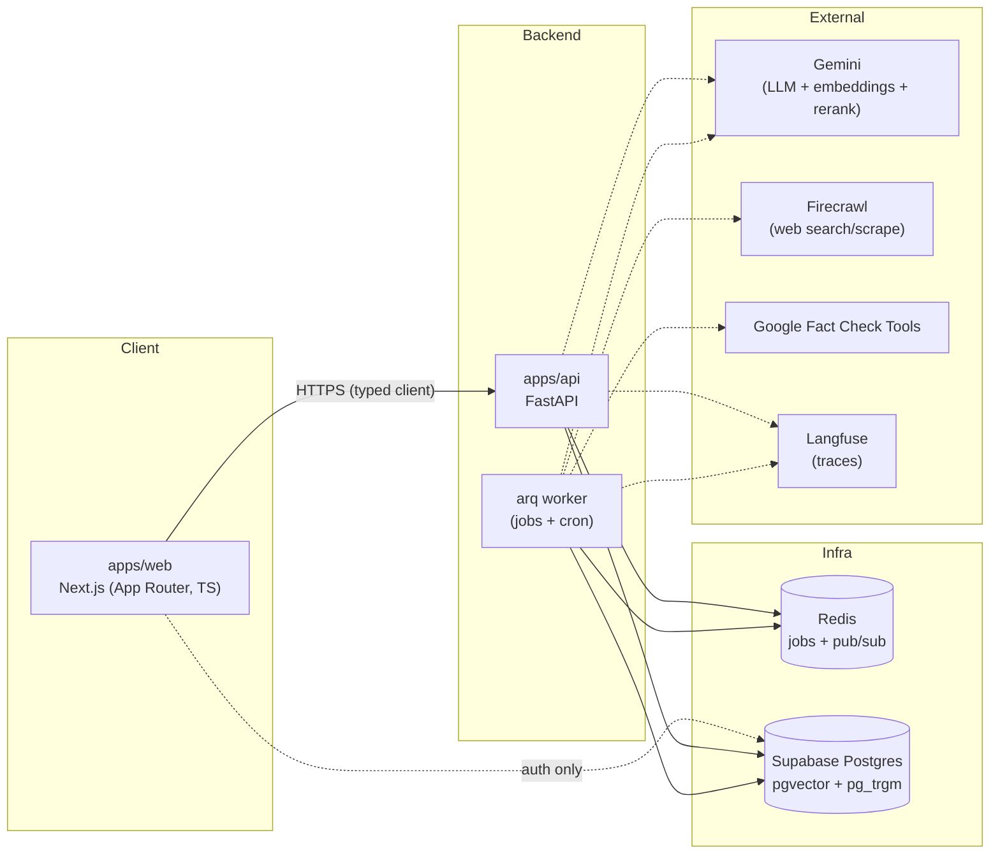

# Architecture

Kept current as structure evolves (AGENTS.md section 12.10). Phase 0 establishes
the skeleton below; the check flow and data flow are filled in as phases land.

## System overview (Phase 0)

Notes:
- The browser talks to Supabase **for auth only**; all data flows through the
  FastAPI backend (AGENTS.md section 3).
- Retrieval uses **Gemini embeddings + LLM reranker** by default so the backend
  carries no multi-GB local model (see `docs/DECISIONS.md`).
- Dashed edges are external calls; all are traced in Langfuse (no-op without
  keys).

## Check flow (LangGraph)

To be drawn in Phase 4 when the agent graph is implemented (AGENTS.md section
6.1): `normalize_input → extract_claims → await_confirmation (interrupt) →`
per-claim fan-out (`match_factchecks → plan_queries → search → select_and_fetch
→ read_evidence → assess_sufficiency ⟲ → compose → verify_citations`) `→
build_graph → propose_memories → finalize`.

## Repository layout

See AGENTS.md section 4 for the full tree. Phase 0 created the backend package
under `apps/api/src/elenchus/`, the frontend under `apps/web/`, `supabase/`,
`docs/` and CI.
